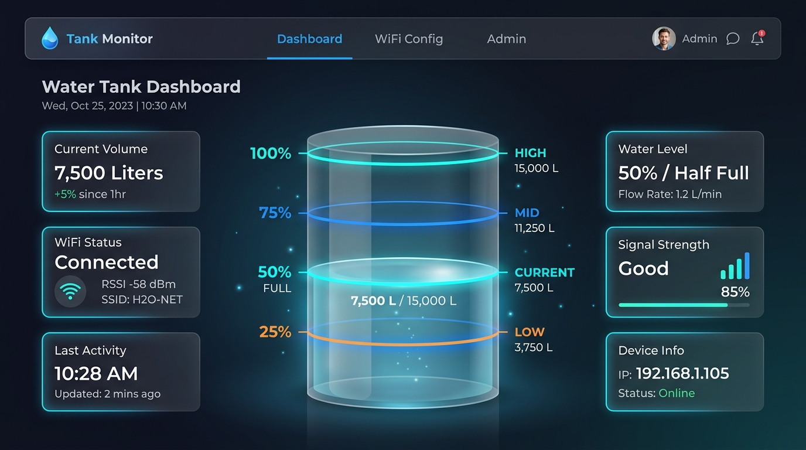
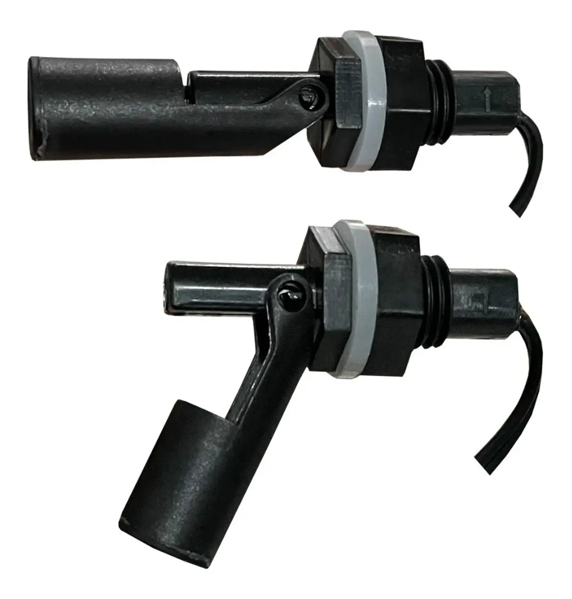

# 🌊 TankMonitor - Monitor de Nível de Caixa d'Água com ESP32

[](https://www.espressif.com/)
[](https://isocpp.org/)
[](LICENSE)
[]()

Sistema IoT de monitoramento residencial para caixa d'água desenvolvido com **ESP32** e **3 sensores magnéticos de nível (boias reed switch)**. O sistema monitora com precisão os patamares de **25% (Reserva)**, **50% (Médio)** e **100% (Cheia)**, emitindo **Alerta Crítico Visual quando o nível cai abaixo de 25%** (todas as boias secas). Permite ainda **personalizar a capacidade total do reservatório em Litros** diretamente pela interface web.

---

## 📸 Interface do Sistema Web



---

## ✨ Principais Recursos

- 💧 **Visualização em Tempo Real com 3 Sensores**: Painel com ilustração cilíndrica translúcida (*glassmorphism*) e animação de onda líquida SVG/CSS em tempo real.
- 🚨 **Alerta Crítico Abaixo de 25%**: Quando o nível d'água fica abaixo do primeiro sensor (todas as boias secas), a interface dispara um banner e animação pulsante em vermelho avisando o risco iminente de desabastecimento.
- 🎛️ **Capacidade do Reservatório Personalizável**: Permite definir os litros totais da caixa d'água (ex: 500 L, 1.000 L, 2.000 L, 5.000 L, etc.) na aba de configurações. O volume atual em litros é calculado e exibido dinamicamente e salvo na memória Flash NVS permanente.
- 📶 **Configuração Wi-Fi Automática (Captive Portal)**: Se não houver Wi-Fi configurado ou se o roteador for trocado, o ESP32 cria a rede `CaixaDagua-Setup` e abre automaticamente a tela de configuração em `192.168.4.1`.
- 🔍 **Varredura Ativa de Redes**: O ESP32 escaneia as redes Wi-Fi 2.4 GHz do local e permite selecionar o SSID pelo menu suspenso.
- 🔐 **Painel Administrativo & Segurança**: Usuário padrão `admin` com senha inicial `admin`, com troca de senha diretamente pelo navegador e salva na memória permanente.
- 🔄 **Botão de Reset de Fábrica**: Segurando o botão físico `BOOT` na placa ESP32 por 5 segundos, o dispositivo apaga os dados de rede e volta para o modo `CaixaDagua-Setup`.
- ⚡ **Zero Componentes Externos**: O circuito aproveita os resistores de pull-up internos do ESP32 (`INPUT_PULLUP`), ligando os sensores diretamente nos pinos sem necessidade de resistores ou placas extras.
- 📦 **Zero Dependências Externas**: Utiliza apenas bibliotecas nativas da Espressif (`WiFi.h`, `WebServer.h`, `DNSServer.h`, `Preferences.h`).

---

## 🛠️ Materiais Necessários



| Item | Qtd | Descrição |
| :--- | :---: | :--- |
| **Módulo ESP32** | 1x | ESP32 DevKit V1 (NodeMCU 30 ou 38 pinos, chip WROOM-32). |
| **Sensores de Nível (Boias)** | 3x | Sensores de nível magnéticos horizontais articulados (Reed Switch em polipropileno/PP com vedação de silicone). |
| **Fonte de Alimentação** | 1x | Carregador de celular comum 5V (1A ou 2A) com cabo USB. |
| **Cabo de Rede / Fiação** | ~5-15m | Cabo de rede de 4 pares (CAT5/CAT6) para levar o terra e o retorno dos 3 sensores até o ESP32. |
| **Caixa de Proteção** | 1x | Caixa plástica de passagem (tipo Tigre/Amanco ou padrão IP65) para abrigar a placa próximo à caixa d'água. |

> ### 💡 Por que 3 boias magnéticas em vez de hastes metálicas comuns?
> Hastes metálicas com corrente contínua (DC) passando pela água sofrem **eletrólise severa**: fios de cobre ou parafusos comuns enferrujam, criam limo e esfarelam em questão de poucas semanas. As **boias magnéticas tipo reed switch** possuem o circuito elétrico 100% selado a vácuo dentro do plástico. O ímã permanente é quem aciona o contato magnético, proporcionando **anos de vida útil sem corrosão**.

---

## ⚡ Esquema de Ligação Elétrica (3 Sensores)

Graças ao resistor de **Pull-Up interno** ativado no ESP32, basta ligar um lado de cada boia no **GND** e o outro lado no pino digital correspondente:

```text
                  +-----------------------------------+
                  |         ESP32 DEVKIT V1           |
                  |                                   |
                  |  [GND] ---------------+-----------+
                  |                       |
 (Boia 1 - 25%)   |                       |
   Fio 1 ---------+                       |
   Fio 2 ---------------------------------[GPIO 17]
                                          |
 (Boia 2 - 50%)                           |
   Fio 1 ---------+                       |
   Fio 2 ---------------------------------[GPIO 18]
                                          |
 (Boia 3 - 100%)                          |
   Fio 1 ---------+-----------------------+
   Fio 2 ---------------------------------[GPIO 19]
                  |                                   |
                  |  [Micro-USB] <--- 5V Alimentação  |
                  +-----------------------------------+
```

### 📌 Mapeamento dos Níveis e Alerta:
* **Boia 1 (Fundo / Reserva)**: Instalada na altura de **25%**.
* **Boia 2 (Meio)**: Instalada na altura de **50%**.
* **Boia 3 (Topo)**: Instalada na altura de **100%** (próximo à borda/ladrão).

| Boia 1 (GPIO 17) | Boia 2 (GPIO 18) | Boia 3 (GPIO 19) | Nível na Tela | Volume (Ex: 1000L) | Status e Alerta |
| :---: | :---: | :---: | :---: | :---: | :--- |
| **Seca** | **Seca** | **Seca** | **< 25%** | **< 250 L** | 🚨 **ALERTA CRÍTICO: Risco de Falta d'Água!** |
| **Submersa** | **Seca** | **Seca** | **25%** | **250 L** | Nível de Reserva (Atenção) |
| **Submersa** | **Submersa** | **Seca** | **50%** | **500 L** | Nível Médio (Normal) |
| **Submersa** | **Submersa** | **Submersa** | **100%** | **1.000 L** | Caixa Cheia (Completo) |
| *Seca* | *Submersa* | *Seca* | *⚠️ Erro* | *--* | Falha/Boia travada (Diagnóstico inteligente) |

> ⚠️ **Dica de Instalação**: Instale as boias com a **setinha gravada no corpo plástico apontando para CIMA**. Assim, quando a água subir e levantar a boia, ela fechará contato com o terra (GND), acionando o nível.

---

## 💻 Passo a Passo para Gravar no ESP32

### Método 1: Usando a Arduino IDE

1. **Baixe e instale** a [Arduino IDE](https://www.arduino.cc/en/software).
2. Abra a IDE e vá em **Arquivo > Preferências** (`Ctrl + ,`).
3. No campo **URLs Adicionais para Gerenciadores de Placas**, adicione o link oficial da Espressif:
   ```text
   https://raw.githubusercontent.com/espressif/arduino-esp32/gh-pages/package_esp32_index.json
   ```
4. Vá em **Ferramentas > Placa > Gerenciador de Placas**, procure por `esp32` (por Espressif Systems) e instale.
5. Abra o arquivo [esp32-water-tank-monitor.ino](esp32-water-tank-monitor.ino) (o arquivo `web_pages.h` abrirá junto em uma aba ao lado).
6. Conecte o ESP32 ao computador usando um **cabo USB com linhas de dados**.
7. Em **Ferramentas > Placa**, selecione **DOIT ESP32 DEVKIT V1** (ou *ESP32 Dev Module*).
8. Em **Ferramentas > Porta**, selecione a porta COM correspondente.
9. Clique no botão de **Carregar (Upload)**.

---

## 📲 Primeiro Acesso e Configuração

1. Ao ligar a placa pela primeira vez, ela criará a rede Wi-Fi aberta:
   ```text
   CaixaDagua-Setup
   ```
2. Conecte-se com seu celular ou computador e acesse:
   ```text
   http://192.168.4.1
   ```
3. Na aba **Config Wi-Fi**, clique em **Escanear Redes Wi-Fi Próximas**, escolha o Wi-Fi da sua casa, digite a senha e salve.
4. Na aba **Config & Admin**, defina a **Capacidade Total do seu Reservatório em Litros** (ex: 500, 1000, 2000) e altere a senha do admin se desejar.
5. O ESP32 reiniciará e conectará automaticamente na sua rede local!

---

## 🧪 Simulador em Navegador (Testes Rápidos)

O projeto inclui o arquivo [`dashboard_preview.html`](dashboard_preview.html). 
Dê um **duplo clique** nele para abri-lo no seu navegador e testar a física da água nos 3 sensores, a simulação do **Alerta Crítico (< 25%)**, o cálculo de litros editável e o painel de administração em bancada!

---

## 📂 Estrutura do Projeto

```text
Tankmonitor/
├── assets/
│   ├── dashboard_ui.jpg       # Imagem do painel de monitoramento
│   └── sensor_boia.png        # Foto dos sensores de nível
├── esp32-water-tank-monitor.ino # Firmware C++ para ESP32
├── web_pages.h                # Interface web responsiva em PROGMEM
├── dashboard_preview.html     # Simulador interativo em HTML/CSS/JS
├── GUIA_MONTAGEM.md           # Guia elétrico e manual de instalação
├── LICENSE                    # Licença aberta MIT
└── README.md                  # Documentação completa
```

---

## 👤 Autor

Desenvolvido por **Tiago Patriarca**  
GitHub: [@tiagopatriarca](https://github.com/tiagopatriarca)

---

## 📄 Licença

Este projeto é distribuído sob a licença **MIT**. Consulte o arquivo [LICENSE](LICENSE) para obter mais detalhes.
